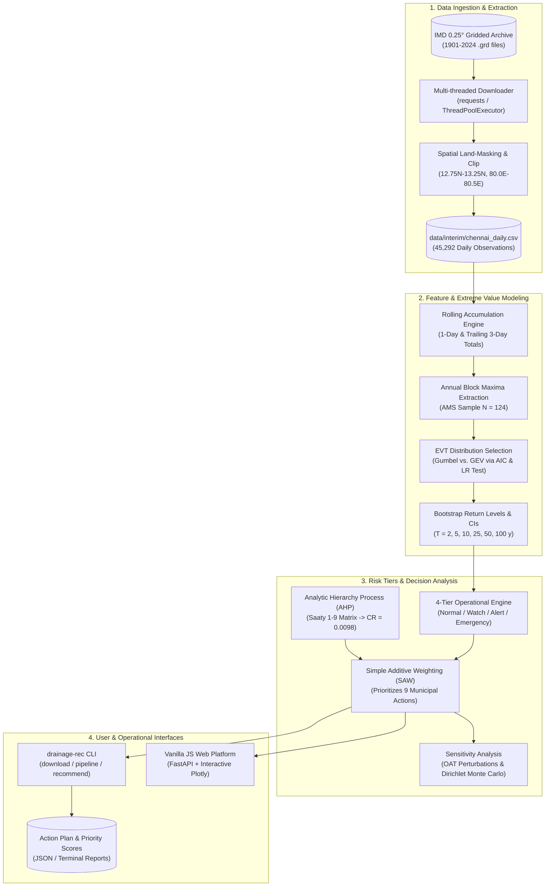

# 🌧️ Chennai Drainage Preparedness Recommender (`drainage-rec`)

[](https://www.python.org/downloads/)
[](https://opensource.org/licenses/MIT)
[](https://fastapi.tiangolo.com/)
[](https://github.com/psf/black)

An operational, data-driven decision-support system designed to translate incoming and historical rainfall into risk-tiered urban drainage preparedness actions for Chennai, India.

---

## 📌 Executive Summary & Context

The coastal metropolis of Chennai experiences intense, concentrated precipitation during the Northeast Monsoon (October–December). Severe hydrometeorological events frequently threaten the city with devastating urban flooding (e.g., the historic December 2015 deluge, Cyclone Vardah in 2016, November 2021 inundation, and Cyclone Michaung in December 2023).

Civic authorities—including the **Greater Chennai Corporation (GCC)**, **Water Resources Department (WRD)**, and disaster management agencies—face two critical operational hurdles under acute forecast lead times:
1. **Disentangling Acute Intensity vs. Cumulative Volume**: Urban flooding can be triggered by sudden cloudbursts (1-day flash flooding overwhelming street inlets) or sustained multi-day precipitation (3-day accumulations causing reservoir storage exceedance and canal spillovers).
2. **Action Prioritization Under Scarcity**: Municipal resources (dewatering pumps, rescue boats, desilting machinery, shelter staff) are strictly finite. Deciding *which* action to deploy first across operational criteria (impact, urgency, lead time, affordability, feasibility) requires a statistically robust, transparent, and reproducible framework.

`drainage-rec` addresses this by coupling **124 years of gridded daily climatology (1901–2024)** from the India Meteorological Department (IMD) with **Extreme Value Theory (EVT)** and **Multi-Criteria Decision Analysis (AHP + MCDA)**.

---

## 🏛️ System Architecture



---

## 🚀 Key Features

- **124 Years of Daily Precipitation (1901–2024)**: High-resolution historical baseline derived from IMD's 0.25° gridded daily rainfall dataset, masking ocean cells over the Bay of Bengal.
- **Dual-Duration Feature Tracking**: Evaluates 1-day acute rainfall ($R_{1d}$) alongside trailing 3-day cumulative rainfall ($R_{3d} = R_t + R_{t-1} + R_{t-2}$) to detect both flash flooding and volumetric buildup.
- **Extreme Value Statistics**: Fits Generalized Extreme Value (GEV) and Gumbel distributions to annual block maxima via MLE, utilizing Akaike Information Criterion (AIC) and Likelihood Ratio hypothesis tests. For Chennai, Gumbel is statistically selected for both series.
- **Nonparametric Bootstrap Uncertainty**: Produces 95% confidence intervals on return levels ($2\text{ to } 100\text{ years}$) using 500 bootstrap resamples.
- **Four Operational Risk Tiers**:
  - **Normal**: $< 95\text{th}$ percentile wet-day rain. Routine operations.
  - **Watch**: $\ge 95\text{th}$ percentile wet-day rain ($R_{1d} \ge 57.7\text{ mm}$ or $R_{3d} \ge 103.0\text{ mm}$). Early mobilization.
  - **Alert**: $\ge 2\text{-year}$ return period on annual maxima ($R_{1d} \ge 113.7\text{ mm}$ or $R_{3d} \ge 202.8\text{ mm}$). Active field response.
  - **Emergency**: $\ge 10\text{-year}$ return period on annual maxima ($R_{1d} \ge 192.5\text{ mm}$ or $R_{3d} \ge 336.1\text{ mm}$). Full disaster mobilization.
- **Multi-Criteria Action Prioritization (AHP)**: Weights 5 operational criteria (Impact 40.8%, Urgency 25.1%, Lead Time 14.5%, Feasibility 13.2%, Affordability 6.4%) with a Consistency Ratio of $\text{CR} = 0.0098 \ll 0.10$.
- **Empirical Validation on Ground Truth Floods**: Achieves a **100% Hit Rate on Alert+** and **71.4% on Emergency** across Chennai's major recorded floods (2005, 2015, 2016, 2021, 2023).
- **Interactive Web Platform**: FastAPI serves a dependency-free JavaScript dashboard with rainfall forecast, zone population priorities, and power-station profiles.

---

## 📦 Quick Start Guide

### 1. Prerequisites
- Python $\ge 3.10$
- Virtual environment tool (`uv`, `venv`, or `conda`)

### 2. Installation

Using `uv` (recommended):
```bash
uv venv
source .venv/bin/activate       # On Windows: .venv\Scripts\activate
uv pip install -e .
```

Or using standard `pip`:
```bash
python -m venv .venv
source .venv/bin/activate       # On Windows: .venv\Scripts\activate
pip install -e .
```

### 3. Fetch Data & Build Series
Download the 1901–2024 IMD daily rainfall grids and extract the Chennai time series:
```bash
make data
# Or directly via CLI:
drainage-rec download --start 1901 --end 2024 --workers 3
```

### 4. Execute the Analytical Pipeline
Fit statistical distributions, compute return levels, classify 124 years of daily history, solve the AHP matrix, and generate processed tables:
```bash
make pipeline
# Or directly via CLI:
drainage-rec pipeline
```

### 5. Launch the Web Platform
```bash
make dashboard
# Or directly:
.venv/bin/uvicorn drainage_rec.web_api:app --reload
```
Open your browser at `http://localhost:8000`.

### 6. Run Operational Recommendations via CLI
Input any observed or forecasted 1-day and 3-day rainfall:
```bash
drainage-rec recommend --rain-1d 120 --rain-3d 250
```

*Output:*
```text
Tier: Alert
  rain_1d: 120.0 mm  -> 99.2 pct (wet days), return period 2.3 y
  rain_3d: 250.0 mm  -> 99.3 pct (wet days), return period 3.3 y
Recommended actions (highest priority first):
  1. [0.877] Activate 24x7 flood control room and ward-level teams
  2. [0.840] Pre-position dewatering pumps at known low-lying subways
  3. [0.810] Coordinate staged releases from Chembarambakkam / Puzhal reservoirs
  4. [0.786] Issue public rainfall advisory via SMS / social media
  5. [0.707] Inspect and clear storm-drain inlets and culverts
  6. [0.561] Targeted desilting of major canals (Buckingham, Otteri Nullah, Cooum mouth)
```

JSON output is also supported for integration with external APIs or alert dispatch pipelines:
```bash
drainage-rec recommend --rain-1d 210 --rain-3d 390 --json
```

---

## ☁️ Deployment (Vercel)

The FastAPI app is both the API and the frontend host. `app.py` exposes the ASGI
`app`, Vercel routes every request to it, and FastAPI serves `web/` at `/` plus the
JSON endpoints under `/api/*`.

### One-time project setup

1. Push this branch to GitHub (the two runtime data artifacts are committed — see below).
2. In [Vercel](https://vercel.com/new), **Import** the repository.
3. Keep the defaults: root directory = repo root, framework preset **FastAPI**
   (auto-detected from `app.py`), no build command override.
4. Deploy. Vercel reads the Python version from `.python-version` (3.12).
5. Verify `https://<project>.vercel.app/api/health` returns `{"status":"ok"}`.

No environment variables or secrets are required.

### What makes it deployable

| File | Purpose |
| :--- | :--- |
| `app.py` | Vercel entrypoint; puts `src/` on `sys.path` so the package works without an editable install |
| `requirements.txt` | Lean runtime only (FastAPI, uvicorn, numpy, pandas, scipy, pyyaml), keeping the bundle well inside Vercel's 500 MB Python limit |
| `.python-version` | Pins Python 3.12 (Vercel supports 3.12–3.14) |
| `vercel.json` | Mumbai region (`bom1`), 60 s max duration, excludes tests/docs/raw data from the bundle |
| `.vercelignore` | Keeps the upload small (raw IMD grids, years/, docs, tests) |
| `web/plotly-basic.min.js` | Vendored 1.19 MB bundle; the full 4.59 MB plotly.js exceeds Vercel's 4.5 MB response cap |
| `data/processed/model.json`, `data/interim/chennai_daily.csv` | Loaded at import; committed because rebuilding them needs the full IMD archive |

### Cold starts

The API fits the logistic heavy-rain model and loads `model.json` during import,
so the first request after an idle period takes roughly 5 seconds. Warm requests
take milliseconds. This can be optimised later by serialising the fitted model.

### Refreshing deployed data

```bash
make data      # only when the IMD archive changes
make pipeline
git add data/processed/model.json data/interim/chennai_daily.csv
git commit -m "Refresh model artifacts"
git push       # Vercel redeploys automatically
```

---

## 🌐 Deployment (GitHub Pages)

GitHub Pages serves static files only, so this branch ships a **client-side port of
the API** instead of the FastAPI service. The interface and the numbers are the
same; there is no server and no cold start.

### How it works

| Piece | Role |
| :--- | :--- |
| `scripts/export_static_site.py` | Runs the real Python models and writes `_site/`: a copy of `web/` plus `data/bootstrap.json`, `data/power-stations.json`, and `data/static-model.json` (fit parameters, wet-day climatology, logistic coefficients) |
| `web/static-api.js` | Intercepts the frontend's `/api/*` fetches and reimplements `/api/forecast` and `/api/population-priority` in the browser (percentile, return period, tiering, logistic probability, zone scoring, crew allocation). Injected into `_site/index.html` only, so Vercel keeps the real backend |
| `.github/workflows/pages.yml` | Builds `_site/`, verifies parity, and deploys with `actions/deploy-pages` |
| `scripts/check_static_parity.py` | Compares the JavaScript results against the Python endpoints on forecast and 10-zone scenarios; the workflow fails on any drift above `1e-9` |

### One-time setup

1. Push `feat/github-pages` to GitHub.
2. Repo **Settings → Pages → Build and deployment → Source: GitHub Actions**.
3. The push runs the **Deploy static site to GitHub Pages** workflow; the site is
   published at `https://<owner>.github.io/drain-prep/` (the workflow's run page
   shows the exact URL).

To publish from `main` instead, change the `branches` trigger in
`.github/workflows/pages.yml`.

### Local preview

```bash
python scripts/export_static_site.py
python scripts/check_static_parity.py      # requires Node 18+
python -m http.server 8000 --directory _site
```

Open `http://localhost:8000`. Everything runs client-side, so the browser console
must stay clean and no `/api/*` request should reach the network.

### Refreshing the published data

The site embeds the model artifacts at build time. After `make pipeline`:

```bash
python scripts/export_static_site.py
git add data/processed/model.json data/interim/chennai_daily.csv
git commit -m "Refresh model artifacts"
git push        # workflow rebuilds and redeploys
```

### Limitations

- The Python API is the reference implementation; `web/static-api.js` duplicates
  its risk and allocation logic. `scripts/check_static_parity.py` guards against
  divergence — run it after changing either side.
- There is no server-side validation, persistence, or rate limiting; the static
  endpoint checks mirror the Pydantic bounds but are advisory only.
- The station table and model metadata are snapshots from the last build.

---

## 📋 Municipal Actions & Priority Rankings

The model prioritizes 9 core municipal actions configured in [`configs/actions.yaml`](file:///c:/Users/krish/Desktop/dev/drain-prep/configs/actions.yaml). Actions trigger cumulatively based on the active risk tier:

| Action ID | Action Description | Trigger Tier | Composite SAW Score | Default Priority Rank |
| :--- | :--- | :---: | :---: | :---: |
| `control_room` | Activate 24x7 flood control room and ward-level teams | **Alert** | **0.8766** | **#1** |
| `rescue_teams` | Pre-deploy NDRF/SDRF boats and rescue teams | **Emergency** | **0.8509** | **#2** |
| `pump_deployment` | Pre-position dewatering pumps at known low-lying subways | **Alert** | **0.8399** | **#3** |
| `power_isolation` | Pre-emptive power isolation in inundation-prone feeders | **Emergency** | **0.8290** | **#4** |
| `shelter_readiness` | Open relief shelters and stock food, water, medicines | **Emergency** | **0.8219** | **#5** |
| `reservoir_release` | Coordinate staged releases from Chembarambakkam / Puzhal | **Alert** | **0.8102** | **#6** |
| `public_advisory` | Issue public rainfall advisory via SMS / social media | **Watch** | **0.7865** | **#7** |
| `drain_inspection` | Inspect and clear storm-drain inlets and culverts | **Watch** | **0.7074** | **#8** |
| `desilting` | Targeted desilting of major canals (Buckingham, Cooum) | **Watch** | **0.5608** | **#9** |

---

## 🔬 Historical Validation Highlights

Empirical validation against recorded major flood events in Chennai demonstrates strong predictive alignment:

| Event | Dates | Peak Tier | Max Rain (1d / 3d) | Return Period | Severity Percentile |
| :--- | :---: | :---: | :---: | :---: | :---: |
| **Nov 2015 Deluge** | 08–24 Nov 2015 | **Emergency** | 289.4 / 323.3 mm | **96.5 years** | 99.99% |
| **Dec 2015 Catastrophe** | 30 Nov – 05 Dec 2015 | **Emergency** | 348.5 / 449.5 mm | **394.6 years** | 100.00% |
| **Cyclone Michaung** | 02–05 Dec 2023 | **Emergency** | 195.5 / 384.7 mm | **19.4 years** *(driven by 3-day)* | 99.96% |
| **Nov 2021 Floods** | 06–12 Nov 2021 | **Alert** | 153.9 / 233.8 mm | **4.3 years** | 99.82% |
| **Cyclone Vardah** | 11–13 Dec 2016 | **Alert** | 114.1 / 154.2 mm | **2.0 years** | 99.52% |
| **Oct 2005 Floods** | 26–28 Oct 2005 | **Emergency** | 217.3 / 386.5 mm | **19.9 years** | 99.96% |
| **Dec 2005 Floods** | 01–04 Dec 2005 | **Emergency** | 250.6 / 278.8 mm | **38.5 years** | 99.97% |

- **Alert+ Hit Rate**: **100% (7/7 events)**
- **Emergency Hit Rate**: **71.4% (5/7 events)**

---

## 📁 Repository Layout

```
drain-prep/
├── Makefile                                # Top-level build and run commands
├── app.py                                  # Vercel ASGI entrypoint
├── vercel.json                             # Vercel region and bundle configuration
├── .python-version                         # Python 3.12 for the Vercel build
├── .github/workflows/pages.yml             # GitHub Pages build and deploy
├── pyproject.toml                          # Build definitions and package dependencies
├── configs/                                # Declarative YAML configuration files
│   ├── study_area.yaml                     # Spatial bounding box and grid aggregation rules
│   ├── thresholds.yaml                     # Risk tier criteria (percentiles and return periods)
│   ├── weights.yaml                        # AHP pairwise comparisons and sensitivity configs
│   └── actions.yaml                        # Municipal action catalog and criteria ratings
├── data/                                   # Data directory (raw, interim, processed, external)
├── docs/                                   # In-depth technical documentation
│   ├── index.md                            # Documentation hub and overview
│   ├── explanation.md                      # Complete CSE student & developer rebuild blueprint
│   ├── architecture.md                     # Detailed system and software architecture
│   ├── methodology.md                      # Mathematical, statistical, and hydrological theory
│   ├── data_pipeline.md                    # Data pipeline, extraction, and processed schema dictionary
│   ├── decision_model.md                   # Multi-criteria decision analysis (AHP + SAW)
│   ├── validation_and_benchmarks.md        # Historical flood scorecard and case studies
│   └── cli_and_api.md                      # Complete CLI options and Python API reference
├── scripts/                                # Automation scripts
│   ├── run_pipeline.py                     # Pipeline execution runner
│   ├── generate_report_figures.py          # Static matplotlib figure generator
│   ├── export_static_site.py               # Builds the GitHub Pages site (_site/)
│   └── check_static_parity.py              # Python-vs-JavaScript API parity check
├── src/drainage_rec/                       # Core Python package
│   ├── cli.py                              # CLI entrypoint
│   ├── pipeline.py                         # End-to-end analytical pipeline
│   ├── recommend.py                        # Real-time inference engine
│   ├── data/                               # Data fetching, clipping, and extraction
│   ├── features/                           # Rolling accumulations and annual maxima
│   ├── stats/                              # GEV/Gumbel fitting, return periods, trends
│   ├── risk/                               # RiskModel and 4-tier classification logic
│   ├── decision/                           # AHP, SAW matrix, and sensitivity engines
│   ├── validation/                         # Historical backtesting and hit-rate evaluation
│   ├── web_api.py                           # FastAPI models API and static web server
│   ├── dashboard/theme.py                   # Shared report-figure styling
│   └── utils/                              # YAML loaders and I/O helpers
├── web/                                    # Vanilla JavaScript client (served by FastAPI)
│   ├── index.html                          # Single-page shell
│   ├── app.js                              # Dashboard logic and Plotly charts
│   ├── static-api.js                       # GitHub Pages shim for /api/* (not on Vercel)
│   ├── plotly-basic.min.js                 # Vendored chart bundle (fits Vercel response cap)
│   └── src/styles.css                      # Styles
└── tests/                                  # Comprehensive pytest suite
```

---

## 📖 In-Depth Documentation

For detailed technical references, refer to the guides in the [`docs/`](file:///c:/Users/krish/Desktop/dev/drain-prep/docs/) directory:

- [**CSE Student & Developer Blueprint**](file:///c:/Users/krish/Desktop/dev/drain-prep/docs/explanation.md): **The definitive rebuild guide**. Written specifically for Computer Science & Engineering students, explaining the mathematical intuition, algorithm derivations, data structures, and step-by-step code modules needed to rebuild this system from scratch without any external reference.
- [**System Architecture & Design**](file:///c:/Users/krish/Desktop/dev/drain-prep/docs/architecture.md): Data flow, modular layout, storage formats, and design principles.
- [**Mathematical & Statistical Methodology**](file:///c:/Users/krish/Desktop/dev/drain-prep/docs/methodology.md): GEV/Gumbel block maxima, AIC model selection, bootstrap return levels, Mann-Kendall trend tests, and AHP derivations.
- [**Data Pipeline & Ingestion**](file:///c:/Users/krish/Desktop/dev/drain-prep/docs/data_pipeline.md): IMD archive streaming, spatial masking, and complete column-by-column schema dictionary.
- [**Decision Model & AHP**](file:///c:/Users/krish/Desktop/dev/drain-prep/docs/decision_model.md): Criteria definitions, Saaty matrix consistency, action rankings, and sensitivity evaluation.
- [**Empirical Validation & Benchmarks**](file:///c:/Users/krish/Desktop/dev/drain-prep/docs/validation_and_benchmarks.md): Historical flood event evaluations, case study breakdowns, and hit-rate analysis.
- [**CLI & Python Developer API**](file:///c:/Users/krish/Desktop/dev/drain-prep/docs/cli_and_api.md): Command flags, Python API recipes, configuration schemas, and instructions for extending the system.

---

## 🧪 Testing & Quality Assurance

Run the automated test suite covering accumulations, distribution fits, return period calculations, AHP consistency, and risk monotonicity:

```bash
pytest -v
# Or via Makefile:
make test
```

---

## 📄 License

This project is licensed under the MIT License. See [LICENSE](LICENSE) for details.
