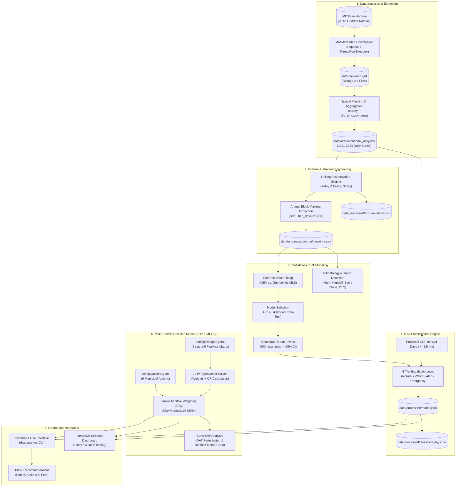

# System Architecture & Design

`drainage-rec` is structured as a decoupled, reproducible scientific data and decision engine. It separates hydrological data extraction, statistical extreme-value modeling, multi-criteria decision analysis, and interactive visualization into modular layers.

---

## 🏛️ High-Level Architecture

The following diagram illustrates the end-to-end data processing and inference architecture:



---

## 📂 Codebase Structure

The project is organized into a clean Python package under [`src/drainage_rec/`](file:///c:/Users/krish/Desktop/dev/drain-prep/src/drainage_rec/) accompanied by configuration files, command scripts, tests, and structured data storage:

```
drain-prep/
├── Makefile                                # Top-level build and execution targets
├── pyproject.toml                          # Build definitions and package dependencies
├── requirements.txt                        # Pip-compatible dependency pointer
├── configs/                                # Declarative YAML configurations
│   ├── study_area.yaml                     # Spatial bounding box and grid aggregation rules
│   ├── thresholds.yaml                     # Risk tier criteria (percentiles and return periods)
│   ├── weights.yaml                        # AHP pairwise comparisons and sensitivity configs
│   └── actions.yaml                        # Municipal action catalog and criteria ratings
├── data/                                   # Tiered data store (tracked via .gitignore)
│   ├── raw/                                # Temporary binary .grd files from IMD
│   ├── interim/                            # Extracted Chennai daily series and yearly CSVs
│   ├── processed/                          # Serialized models, tables, and JSON outputs
│   └── external/                           # Ground truth flood events catalog
├── docs/                                   # Comprehensive technical and developer documentation
├── scripts/                                # Automation scripts
│   ├── run_pipeline.py                     # CLI pipeline runner
│   └── generate_report_figures.py          # Static matplotlib figure generator
├── src/                                    # Python source code
│   └── drainage_rec/
│       ├── __init__.py                     # Package entry point and version metadata
│       ├── cli.py                          # Unified CLI (download, pipeline, recommend)
│       ├── pipeline.py                     # End-to-end analytical pipeline coordinator
│       ├── recommend.py                    # Inference API (rain inputs -> tier + ranked actions)
│       ├── data/                           # Data fetching, grid clipping, and extraction
│       │   ├── download.py                 # Multi-threaded IMD archive client
│       │   ├── extract.py                  # Spatial sub-setting and city-series construction
│       │   └── load.py                     # Binary IMD grid loader (xarray)
│       ├── features/                       # Hydrological feature engineering
│       │   ├── accumulation.py             # 1-day & trailing 3-day rolling totals
│       │   ├── annual_max.py               # Annual block maxima (AMS) extraction
│       │   └── intensity.py                # Intensity metrics
│       ├── stats/                          # Statistical modeling & EVT
│       │   ├── distributions.py            # GEV & Gumbel MLE fits, AIC, likelihood-ratio test
│       │   ├── return_period.py            # Return levels and bootstrap confidence intervals
│       │   ├── percentiles.py              # Empirical CDF for historical wet days
│       │   ├── frequency.py                # Monthly climatology and exceedance counts
│       │   └── trend.py                    # Mann-Kendall, Sen's slope, OLS, split-period
│       ├── risk/                           # Operational risk classification
│       │   ├── tiers.py                    # RiskModel class and threshold boundary evaluator
│       │   └── classify.py                 # Historical daily classification and episode tracker
│       ├── decision/                       # Multi-criteria decision analysis
│       │   ├── criteria.py                 # Operational criteria definitions
│       │   ├── ahp.py                      # Analytic Hierarchy Process (eigenvector + CR)
│       │   ├── actions.py                  # Municipal action loader and tier filter
│       │   ├── matrix.py                   # Simple Additive Weighting (SAW) normalization
│       │   └── sensitivity.py              # One-At-A-Time and Dirichlet Monte Carlo engines
│       ├── validation/                     # Empirical model validation
│       │   ├── known_events.py             # Historical flood event scorecard and hit rates
│       │   └── backtest.py                 # Alert episode duration and historical backtesting
│       ├── dashboard/                      # Interactive visualization
│       │   ├── app.py                      # Multi-tab Streamlit dashboard
│       │   └── theme.py                    # Color palettes, tier badges, and styling constants
│       └── utils/                          # Common helpers
│           ├── config.py                   # YAML config loader and filesystem paths
│           └── io.py                       # Safe I/O for series, tables, and JSON
└── tests/                                  # Pytest suite
    ├── conftest.py                         # Shared test fixtures (synthetic rainfall series)
    ├── test_accumulation.py               # Accumulation window tests
    ├── test_annual_max.py                  # Block maxima extraction tests
    ├── test_distributions.py               # GEV/Gumbel fitting and LR tests
    ├── test_return_period.py               # Return level calculation tests
    ├── test_tiers.py                       # Monotonicity and tier escalation tests
    ├── test_ahp.py                         # AHP matrix consistency tests
    ├── test_matrix.py                      # SAW scoring and ranking tests
    └── test_trend.py                       # Mann-Kendall and Sen's slope tests
```

---

## 🔄 Data Lifecycle & Transformations

The system operates across four well-defined data layers:

1. **Raw Layer (`data/raw/`)**:
   - Holds 0.25° gridded binary files (`.grd`) downloaded directly from the IMD National Climate Center archive via HTTP POST requests.
   - Files are validated against expected byte lengths based on leap-year status ($365$ or $366$ days) before being committed to disk.
   - Raw grids can be discarded once extracted, preserving disk space (~25 MB per year).

2. **Interim Layer (`data/interim/`)**:
   - Stores per-year extracted CSV files under `data/interim/years/<year>.csv`.
   - Each file contains individual valid grid cell values and the spatially aggregated Chennai daily rainfall series `rain_mm`.
   - Combined into a consolidated, continuous 124-year daily time series: `data/interim/chennai_daily.csv`.

3. **Processed Layer (`data/processed/`)**:
   - Stores all outputs generated by [`drainage_rec.pipeline.run_pipeline()`](file:///c:/Users/krish/Desktop/dev/drain-prep/src/drainage_rec/pipeline.py):
     - `accumulations.csv`: 1-day and 3-day rolling rainfall totals.
     - `annual_maxima.csv`: Annual block maxima and dates of occurrence.
     - `distribution_fits.csv`: Fitted distribution parameters, AIC, log-likelihood, and Kolmogorov-Smirnov statistics.
     - `return_levels.csv`: Estimated return levels ($2, 5, 10, 25, 50, 100\text{ years}$) with bootstrap $95\%$ confidence bounds.
     - `tier_thresholds_mm.csv`: Millimeter thresholds for each risk tier.
     - `classified_days.csv`: Every historical day annotated with its risk tier, return period, and driver.
     - `action_scores.csv`: Prioritized municipal actions with computed utility scores and ranks.
     - `model.json`: Self-contained serialized snapshot of the fitted `RiskModel` for low-latency operational inference.
     - `summary.json`: Top-level validation metrics, fit parameters, and sensitivity statistics.

4. **Presentation & Inference Layer**:
   - The CLI and Streamlit dashboard load pre-computed models and data tables directly from `data/processed/`.
   - Inference does not require refitting distributions or recalculating historical timeseries: `Recommender.load()` reads `model.json` and evaluates arbitrary incoming rainfall combinations in sub-millisecond time.

---

## ⚙️ Key Architectural Principles

- **Declarative Configuration**: Core parameters (spatial bounds, aggregation methods, risk tier definitions, criteria weights, action catalogs) are maintained in YAML files in `configs/`, decoupling business logic from analytical code.
- **Idempotency & Caching**: Data downloads track completed years and resume automatically. Pipeline runs are idempotent, producing reproducible processed artifacts.
- **Vectorized Performance**: Core computations (rolling accumulations, ECDF evaluations, GEV probability evaluations, SAW matrix multiplications) leverage NumPy and Pandas vectorization.
- **Strict Separation of Concerns**: Hydrological feature calculation is completely decoupled from statistical fitting, risk classification, and decision scoring.
- **Statistically Defensible Model Selection**: Distributions are selected via AIC and formal hypothesis testing rather than arbitrary choice.
